# AdForge — Generative Advertising Pipeline

AdForge is a **FastAPI** application that turns a **creative brief** (text plus optional reference image) into a **multi-shot advertisement video** with voiceover, music, ambient sound, and a **professional closing promo card**. It orchestrates **OpenAI** models for planning and copy, **RunwayML** for images, video, and audio (via ElevenLabs-backed endpoints), and **FFmpeg** for assembly, transitions, and muxing.

---

## Features

- **End-to-end pipeline**: brief ingestion → storyboard → prompts → reference frames → optional VLM checks → video clips → stitch → animated end card with crossfade → mixed audio → final MP4.
- **Platforms**: aspect ratios for YouTube, Reels, TikTok, LinkedIn, Twitter, Instagram square (`pipeline/state.py`).
- **Quality modes**: preview vs higher-quality video model defaults.
- **Checkpoints**: fingerprint-based resume and reuse of prior sessions under `output/`.
- **Web UI**: `static/index.html` with WebSocket progress.
- **REST API**: session creation, image upload, OpenAPI at `/docs`.

---

## Requirements

- **Python** 3.10+ recommended  
- **FFmpeg** and **ffprobe** on `PATH` (or a standard Windows install location scanned by the orchestrator). Required for concat, end-card motion, crossfade, and audio mux.  
- **API keys** (see below)

---

## Installation

```powershell
cd d:\0_placements\genai\runway
python -m venv .venv
.\.venv\Scripts\activate
pip install -r requirements.txt
```

Create your local secrets file from the template (never commit real keys):

```powershell
copy .env.example .env
```

Edit `.env` and fill in `OPENAI_API_KEY` and `RUNWAYML_API_SECRET`. The app loads `.env` at startup via `python-dotenv` (`server.py` uses `load_dotenv(override=True)`).

---

## Environment variables

See **`.env.example`** in the repo root for a commented template (same variables as below).

| Variable | Purpose |
|----------|---------|
| `OPENAI_API_KEY` | GPT stages: ingestion, enhancement, storyboard, prompts, validation, voiceover script, VLM copy, end-card prompt planning. |
| `RUNWAYML_API_SECRET` | RunwayML: images, video, TTS, SFX; also VLM-related calls where applicable. |
| `RUNWAY_SSL_VERIFY` | Set to `0` only if you hit TLS issues behind corporate SSL inspection (see `pipeline/runway_client.py`). |

Optional: `DRY_RUN` for certain scripts/tests (`test_e2e.py`).

Commit **`.env.example`** only; keep **`.env`** private (do not push secrets).

---

## Run the server

```powershell
python -m uvicorn server:app --host 127.0.0.1 --port 8000 --reload
```

- App: `http://127.0.0.1:8000/`  
- OpenAPI: `http://127.0.0.1:8000/docs`  

On some Windows setups, ports **8000** or **8001** may return **WinError 10013**. Try another port (for example **8765**) or inspect excluded port ranges with:

`netsh interface ipv4 show excludedportrange protocol=tcp`

---

## HTTP and WebSocket overview

| Method | Path | Description |
|--------|------|-------------|
| `GET` | `/` | Web UI (`static/index.html`) |
| `POST` | `/api/upload-image` | Upload image → `data_uri` |
| `POST` | `/api/sessions` | Start pipeline; body matches `GenerateRequest` |
| `GET` | `/api/sessions/{id}/status` | `pending` / `running` / `complete` / `error` |
| `WS` | `/api/ws/{session_id}` | Progress logs and final `pipeline_complete` |

Static renders and downloads are served under `/output/{session_id}/...`.

---

## Tests

```powershell
pytest tests -q --ignore=tests/test_08_e2e_pipeline.py
```

Slow end-to-end Runway tests live in `tests/test_08_e2e_pipeline.py`. Integration tests may expect the server on port **8000** (`tests/test_07_server.py`).

---

## Repository layout

| Path | Role |
|------|------|
| `.env.example` | Template for required env vars; copy to `.env` locally |
| `.gitignore` | Ignores `.env`, `output/`, caches, venvs — see file for full list |
| `server.py` | FastAPI app, sessions, WebSocket fan-out |
| `pipeline/orchestrator.py` | Stage scheduler, stitching, checkpoint hooks |
| `pipeline/state.py` | `PipelineState`, platforms, model credit hints |
| `pipeline/checkpoint.py` | Fingerprints, resume, media copy |
| `pipeline/runway_client.py` | Runway HTTP client |
| `pipeline/end_card.py` | Promo clip animation, crossfade, fallbacks |
| `pipeline/agents/*.py` | One module per stage (+ `end_card_gen.py`) |
| `static/` | Frontend |
| `output/` | Per-session artifacts (created at runtime) |

---

## Pipeline stages (ordered)

| ID | Name | Agent / module | Main outputs |
|----|------|----------------|--------------|
| **1** | Intent Ingestion | `ingestion` | Structured `enriched_brief` from user prompt |
| **2** | Contextual Enhancement | `enhancer` | Creative director fields added to brief |
| **3** | Narrative Sequencing | `story` | `storyboard` shots with durations summing to campaign length |
| **4** | Prompt Engineering | `prompt_gen` | Per-shot Runway image + motion prompts, camera params |
| **5** | Structural Validation | `validator` | LLM validation / fixes on structure |
| **6** | Visual Synthesis | `image_synth` | `images/{shot}_*.jpg`, anchor world lock |
| **6a** | VLM Validation | `vlm_validator` | Vision-language checks / retries |
| **7** | Temporal Synthesis | `video_gen` | `videos/{shot}.mp4` |
| **8** | Non-linear stitching | `end_card_gen`, `end_card`, orchestrator `_stitch` | `final_body.mp4`, optional AI slate, `final.mp4` |
| **9** | Audio production | `audio_gen` | Voiceover, music, ambients, `final_with_audio.mp4` |

---

## Flow diagram — full pipeline

Each subgraph matches one checkpoint stage. Data flows **downstream** through `PipelineState`.

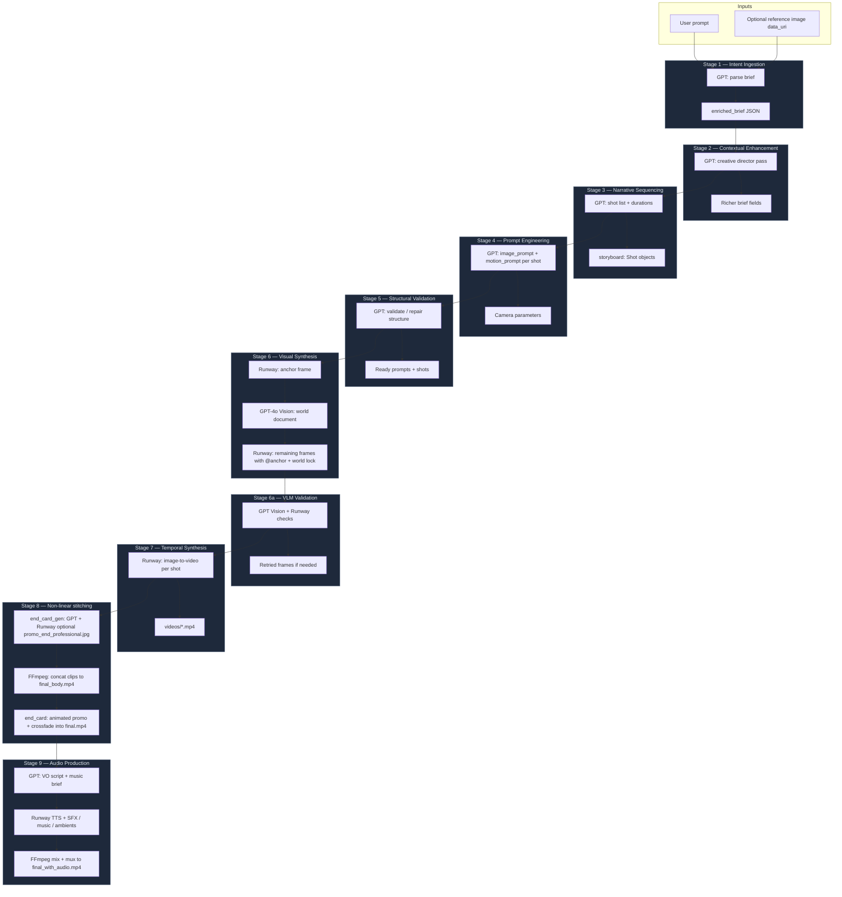

---

## Stage 8 detail (end card + assembly)

Stage 8 combines an **optional AI-generated closing slate**, **clip stitching**, and **cinematic merge** into the main timeline.

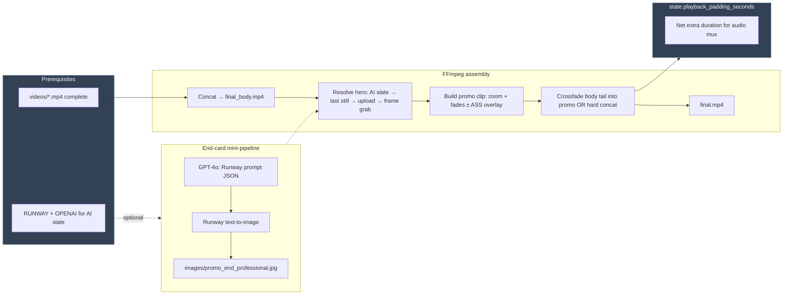

---

## Checkpoint and resume

Runs persist state under `output/{session_id}/checkpoint.json`. A **fingerprint** hashes prompt, image digest, platform, duration, models, and ratio. Matching prior sessions can **skip** completed stages or **replay** a finished run without new API calls.

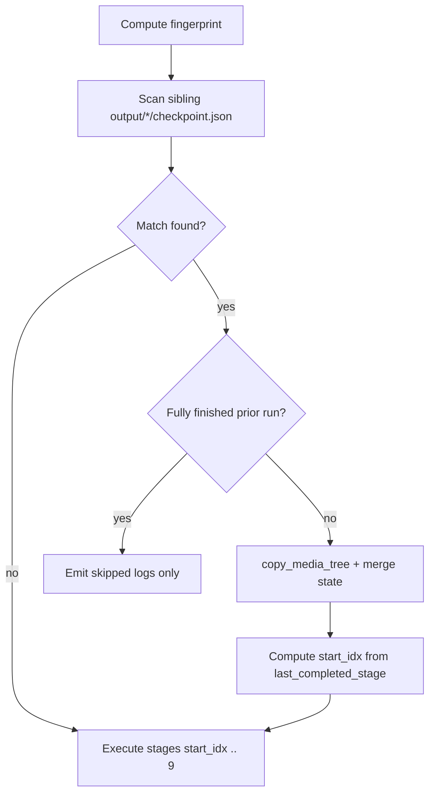

---

## Per-stage Mermaid diagrams

Each diagram shows the **primary inputs → processing → outputs** for that checkpoint stage.

### Stage 1 — Intent Ingestion

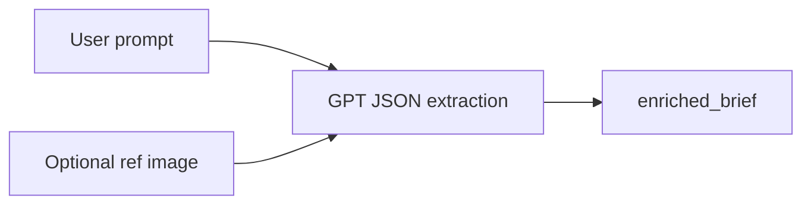

### Stage 2 — Contextual Enhancement

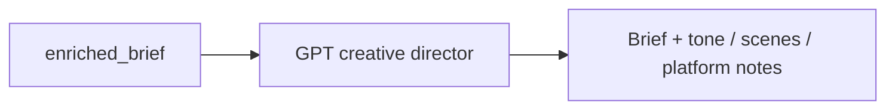

### Stage 3 — Narrative Sequencing

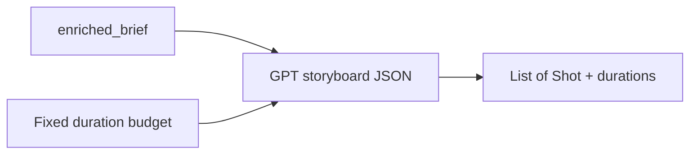

### Stage 4 — Prompt Engineering

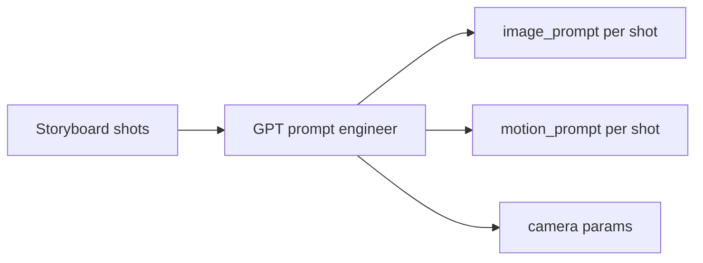

### Stage 5 — Structural Validation

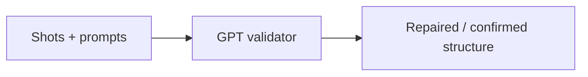

### Stage 6 — Visual Synthesis

```mermaid
flowchart LR
  subgraph A["Phase A — anchor"]
    R1[Runway text-to-image] --> IMG1[shot_01.jpg]
  end
  subgraph W["World lock"]
    IMG1 --> V[GPT-4o Vision world doc]
  end
  subgraph B2["Phase B — others"]
    V --> R2[Runway + @anchor refs]
    H[@hero_ref if any] --> R2
    R2 --> IMGN[shot_02..N.jpg]
  end
```

### Stage 6a — VLM Validation

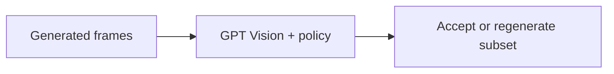

### Stage 7 — Temporal Synthesis

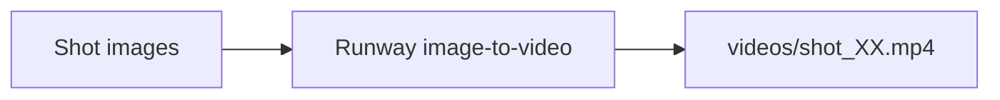

### Stage 8 — Non-linear stitching

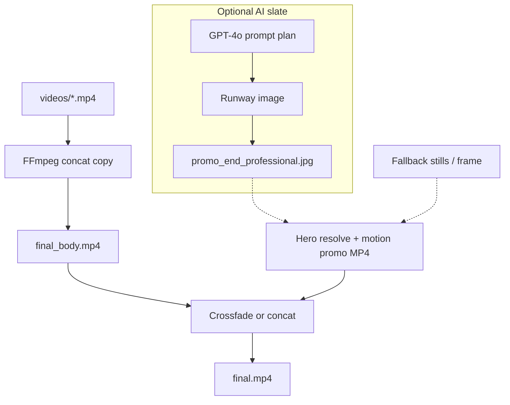

### Stage 9 — Audio Production

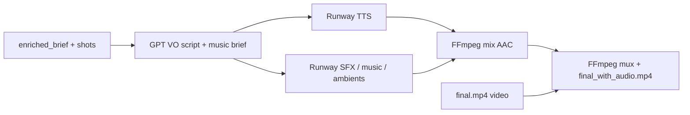

---

## Credits and cost accounting

Rough credit estimates per model live in `pipeline/state.py` (`CREDIT_COST`). Totals accumulate on `PipelineState` during generation.

---

## License / extras

The `skills/` directory contains optional Cursor / Claude plugin assets for Runway documentation and helpers; it is separate from the core FastAPI pipeline.

---

## Troubleshooting

- **FFmpeg not found**: Install FFmpeg and ensure `ffmpeg` / `ffprobe` resolve (PATH or WinGet/Chocolatey paths per orchestrator).
- **Stage 8 promo skipped**: Usually missing hero image and failed frame extract; ensure ffprobe available for crossfade timing on Windows.
- **WebSocket disconnect noise on Windows**: Abrupt tab closes can log `ConnectionResetError`; the pipeline may still complete server-side.
